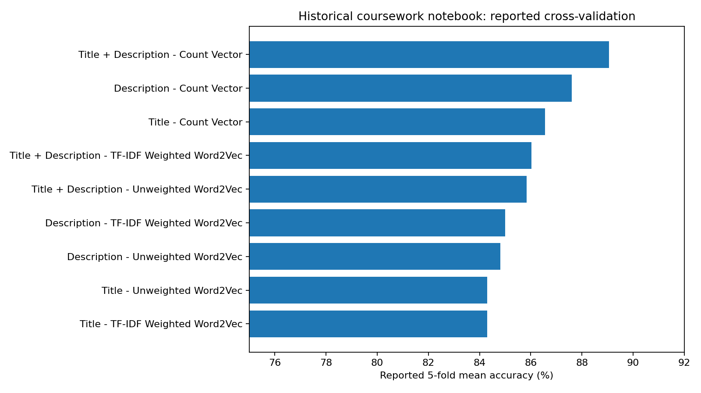

# NLP Clothing Review Classification & Flask Demo

**Python · NLP · scikit-learn · Word2Vec (recovered coursework) · Flask**

## What is original and what is new?

**Recovered coursework:** two original student Milestone I notebooks, an exported preprocessing script and previously saved outputs covering **19,662 processed reviews**, **7,529 vocabulary items** and nine five-fold classification comparisons. The notebook's **historically recorded** best mean accuracy was **89.05%**, using combined titles and descriptions with count vectors and logistic regression. **These original results have not been independently reproduced**: the exact `assignment3.csv`, generated files and course `stopwords_en.txt` were not recovered. The old notebook constructed corpus vocabulary and embeddings before cross-validation, which may inflate validation scores due to representation leakage. Do not equate the historical 89.05% with an unbiased held-out generalisation estimate.

**New portfolio reconstruction:** independent, easy-to-run **CountVectorizer + Logistic Regression** pipeline with a stratified 80/20 train/test split and five-fold CV performed on training data only; Flask `/predict` API; tests. Metrics are written only after training. This reconstruction is **not** the original coursework Flask app or model.

## Research question
Can a customer's written clothing-product review predict whether they recommend the item (`Recommended IND`)? This is a review recommendation label, not a verified product endorsement or subscription churn prediction.

## Run the portfolio baseline

1. Download the **CC0** [Women's E-Commerce Clothing Reviews dataset](https://www.kaggle.com/datasets/nicapotato/womens-ecommerce-clothing-reviews) and save its CSV as `data/womens_clothing_reviews.csv`. See `data/README.md`. The public dataset is a comparable source; **it is not verified as byte-identical to RMIT's original `assignment3.csv`**.
2. Create an environment and install dependencies: `python -m pip install -r requirements.txt`.
3. Run `python -m pytest -q`.
4. Train: `python src/train.py --input data/womens_clothing_reviews.csv`. Inspect `artifacts/metrics.json`.
5. Start the demo: `python src/app.py` and send POST JSON `{"review":"Comfortable material and fits perfectly"}` to `http://127.0.0.1:5000/predict`. Load only model files generated locally.

## Historical coursework evaluation (saved outputs only)

The recovered `coursework_recovered/task2_3.ipynb` compared count vectors, unweighted Word2Vec and TF-IDF-weighted Word2Vec for title-only, description-only and combined text. Reported historical means were **87.60% description/count**, **86.56% title/count**, and **89.05% combined/count**. All nine recorded results are in `results/historical_coursework_cv_results.csv`. No independent re-execution was possible without original inputs.

## Repository structure

- `coursework_recovered/`: earlier notebook and preprocessing sources; historical outputs (not verified anew).
- `src/`: new standalone training pipeline, text normalisation and Flask service.
- `tests/`: unit tests for preprocessing and the service.
- `results/`, `images/`: historical results extracted from saved notebook outputs and their visualisation.
- `data/`: download and attribution instructions; no private/course-provided dataset.

## Limits and provenance

The public source dataset is [Women's E-Commerce Clothing Reviews](https://www.kaggle.com/datasets/nicapotato/womens-ecommerce-clothing-reviews), listed by Kaggle as **CC0**. Evaluation is not live deployment performance. The new baseline differs from the old coursework preprocessing, and no original Flask deployment, Word2Vec model binaries or course dataset were recoverable. The new app is intended as a portfolio demonstration, not production-grade security/deployment.
